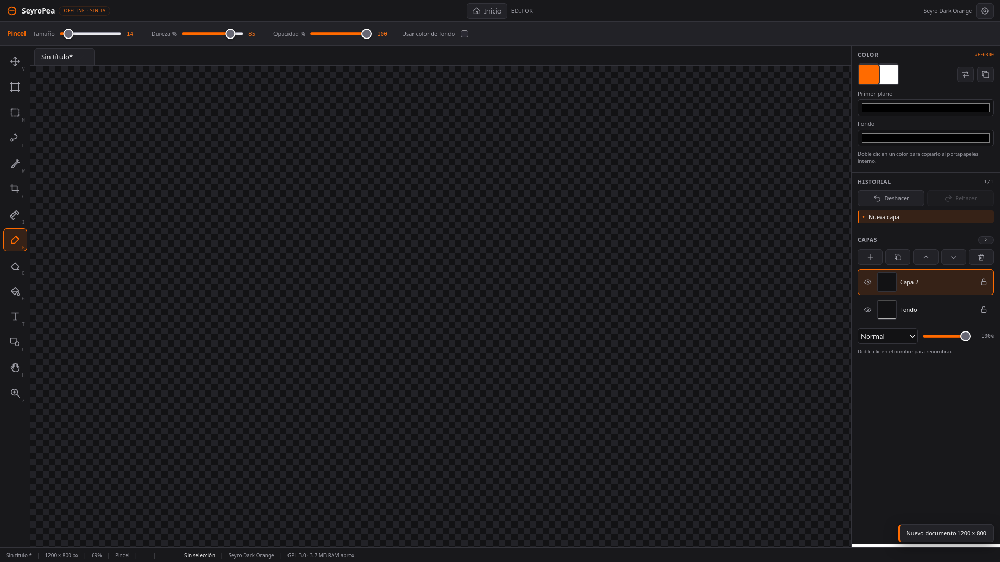
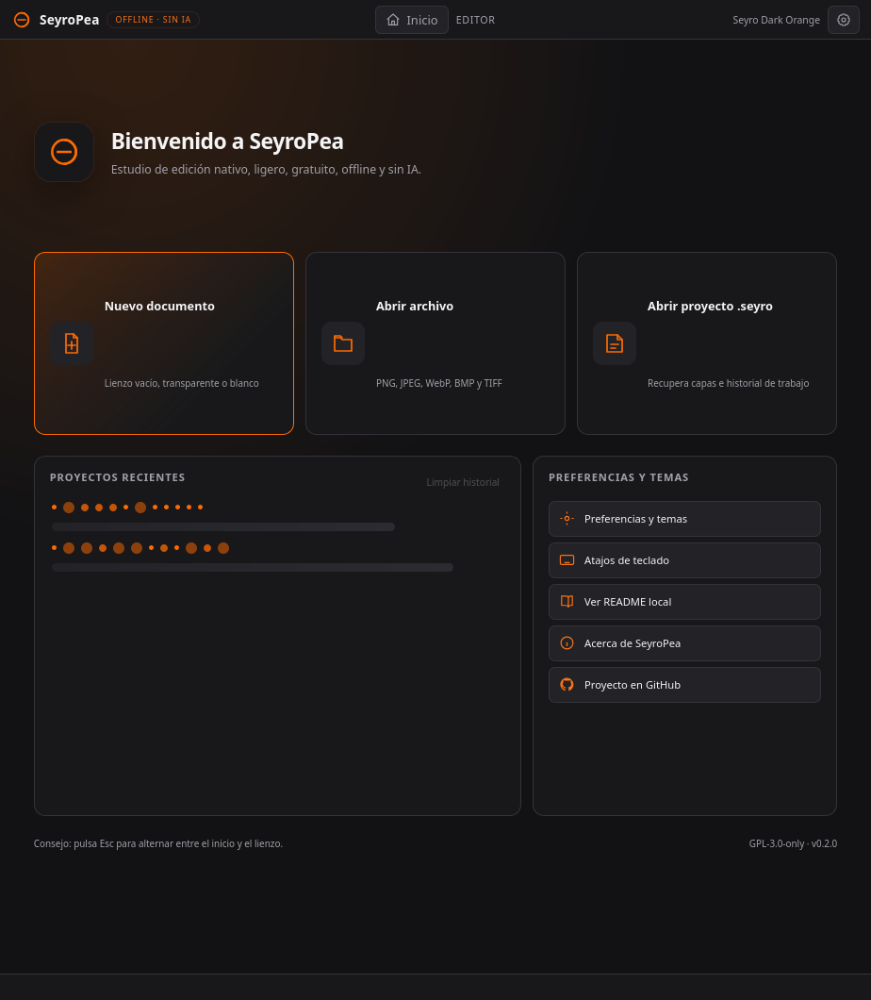

# SeyroPea

**Estudio de edición de imágenes de escritorio: nativo, ligero, gratuito, offline y sin IA.**

SeyroPea v0.2.0 es una aplicación de escritorio real construida con **Tauri v2** y **Canvas2D puro** (JavaScript sin frameworks ni bundler en runtime). El núcleo en Rust gestiona códecs, diálogos nativos, el formato `.seyro`, temas, fuentes, detección de fondo y actualizaciones opcionales.

> Sin cuentas, sin telemetría, sin CDNs, sin modelos generativos. La edición es 100% algorítmica y determinista sobre buffers RGBA.

**Sitio web:** [vdaiki-dev.github.io/seyropea](https://vdaiki-dev.github.io/seyropea/) · **Release actual:** [v0.2.0](https://github.com/vDaiki-dev/seyropea/releases/tag/v0.2.0)

---

## Capturas

**Editor principal** — una sola barra de pestañas, barra de opciones, ajedrezado nítido y paneles laterales.



**Pantalla de inicio** — acceso directo a Nuevo, Abrir, proyectos recientes, preferencias, README, About y GitHub sin salir de la aplicación.



## Características

- **Interfaz estilo Photoshop/Photopea**: una sola barra de pestañas sobre el lienzo, barra de menú nativa, barra de opciones, toolbar, reglas, cuadrícula, ajedrezado nítido, panel de color, historial (≥50 pasos), capas con 15 modos de fusión y barra de estado. Los iconos SVG son locales, gruesos y uniformes; los paneles y botones tienen espaciado consistente.
- **Pantalla de bienvenida**: Nuevo, Abrir imagen, Abrir proyecto `.seyro`, proyectos recientes con metadatos/ruta, limpiar historial, accesos a ajustes, atajos, README, About y GitHub. `Esc` alterna entre Inicio y editor.
- **Herramientas**: mover (`V`), transformar (`Ctrl+T`), marco (`M`), lazo (`L`), varita (`W`), recorte (`C`), cuentagotas (`I`), pincel (`B`), borrador (`E`), cubeta (`G`), texto editable (`T`), formas (`U`), mano (`H`) y zoom (`Z`). La cubeta rellena áreas contiguas o globales con tolerancia, puede muestrear la capa activa o las capas visibles y registra Deshacer/Rehacer.
- **Idiomas**: español, inglés, portugués, hindi, ruso y chino con traducciones amplias; francés, alemán, japonés y árabe como base fácil de ampliar. El selector persiste la elección y cambia también los menús nativos.
- **Filtros y ajustes con vista previa en vivo y comparación**: desenfoque gaussiano y de caja, unsharp, viñeta, ruido determinista, pixelado, brillo/contraste, tono/saturación, niveles, exposición, invertir, desaturar, teñir y transformaciones (rotar/voltear).
- **Capas**: opacidad, visibilidad, bloqueo, duplicado, reordenación, combinación, acoplado y 15 modos Porter-Duff/Photoshop (`normal`, `multiply`, `screen`, `overlay`, `darken`, `lighten`, `color-dodge`, `color-burn`, `hard-light`, `soft-light`, `difference`, `exclusion`, `hue`, `saturation`, `luminosity`).
- **Historial eficiente**: los cambios de píxeles se guardan como parches acotados por *bounding box*; los cambios estructurales usan snapshots. Deshacer/rehacer y salto a cualquier paso.
- **Formato propio `.seyro` v1**: manifiesto JSON + capas RGBA8 comprimidas con DEFLATE. Sin pérdida y versionado. Ver [`docs/FORMAT_SEYRO.md`](docs/FORMAT_SEYRO.md).
- **Temas**: Seyro Dark Orange (por defecto), Dracula, Tokyo Night, Catppuccin Mocha, Nord, Gruvbox Dark y OLED Obsidian; clonación, edición, importación/exportación JSON y tema derivado del fondo de pantalla.
- **Fondo de pantalla**: detección best-effort en X11/Wayland/GNOME/KDE/Hyprland/swww/macOS/Windows, **siempre** con alternativa manual de imagen local. Paleta determinista por cuantización + k-means en HSL.
- **Fuentes del sistema** listadas por Rust; tamaño de UI ajustable y números monoespaciados.
- **Ajustes organizados por secciones**: idioma, apariencia, fondo → paleta, temas personalizados, editor, proyecto y ayuda. Incluye visor del **README local**, botón de GitHub que abre el navegador del sistema, restauración de valores por defecto y control de búsqueda de actualizaciones.
- **Seguridad de trabajo**: el título y las pestañas muestran `*` cuando hay cambios sin guardar; el salir ofrece confirmación y opción de guardar; además se mantiene un respaldo local `.seyro` configurable.
- **Exportación**: PNG, JPEG, WebP y BMP. PNG optimizado con **UPNG.js + pako incluidos localmente** (MIT), con opción de cuantización sin pérdida o con número de colores.
- **Actualizaciones**: consulta opcional a GitHub Releases solo si está activada; si no hay red, falla en silencio.
- **Componentes estándar reutilizables**: `Toast`, `Modal`, `Tooltip`, `Badge` y un `SkeletonLoader` theme-aware inspirado en la matriz de puntos de [DIVAE](https://github.com/intriXlabs/DIVAE) (tres tamaños de punto, patrones deterministas y sin dependencias).
- **Frontera endurecida**: validación de rutas y IDs, escapado de nombres de capas/temas/metadatos y del README local, límites de dimensiones y descompresión para imágenes y `.seyro`, CSP estricto, permisos Tauri mínimos y apertura de URLs sin shell. Archivos corruptos o sobredimensionados fallan con avisos breves, sin crashes.

## Requisitos

 Para ejecutar una compilación ya publicada no se instala Rust: se descarga el paquete de tu plataforma y se abre.

 Para compilar desde el código:

- Rust **1.90+** (se recomienda 1.100 o superior) con `rustup`.
- Linux: `libwebkit2gtk-4.1-dev`, `libgtk-3-dev`, `libayatana-appindicator3-dev`, `librsvg2-dev`, `pkg-config`, `build-essential`.
- macOS: Xcode Command Line Tools.
- Windows: MSVC Build Tools y WebView2.

## Compilación y ejecución

```bash
# Clonar
git clone https://github.com/vDaiki-dev/seyropea.git
cd seyropea

# Cargar Rust en la sesión actual
. "$HOME/.cargo/env"

# Verificación rápida
cargo check --manifest-path src-tauri/Cargo.toml
cargo test  --manifest-path src-tauri/Cargo.toml

# Desarrollo (requiere tauri-cli: cargo install tauri-cli --version '^2')
cargo tauri dev

# Compilación de producción (genera installers en src-tauri/target/release/bundle)
cargo tauri build
```

El frontend se sirve desde `src/frontend`, dentro del binario. **No hay servidor web, npm install ni recursos remotos**.

## Atajos principales

| Tecla | Acción |
| --- | --- |
| `V M L W C I B E G T U H Z` | Herramientas |
| `Esc` | Alternar Inicio / editor |
| `Ctrl+N` / `Ctrl+O` | Nuevo documento / Abrir imagen |
| `Ctrl+S` / `Ctrl+Shift+S` | Guardar `.seyro` / Guardar como |
| `Ctrl+Alt+Shift+S` | Exportar imagen |
| `Ctrl+Z` / `Ctrl+Shift+Z` | Deshacer / Rehacer |
| `Ctrl+T` | Transformación libre |
| `Ctrl+K` | Preferencias, temas y fuentes |
| `Ctrl+0` / `Ctrl+1` | Ajustar a pantalla / Píxeles reales |
| `Ctrl+R` / `Ctrl+'` | Reglas / Cuadrícula |
| `Espacio` | Mano temporal |

La lista completa está en **Ayuda → Atajos de teclado**.

## Inicio, idioma y ayuda

Al abrir la aplicación se muestra la pantalla de bienvenida con accesos directos a crear, abrir imagen, abrir proyecto `.seyro` y retomar recientes. Desde **Preferencias y temas** (`Ctrl+K`) se elige el idioma, la paleta, la fuente, el comportamiento de actualizaciones y el respaldo automático. El mismo panel incluye el README local, el enlace a GitHub, los atajos y la opción de restaurar defaults. **Ayuda → Acerca de** muestra versión, licencia GPL-3.0-only, estado offline/sin IA y créditos.

## Arquitectura

Resumen (detalles en [`docs/ARCHITECTURE.md`](docs/ARCHITECTURE.md)):

```
src-tauri/src/        Rust: codecs, .seyro, security, settings, temas, fuentes, wallpaper, updater, menú, IPC
src/frontend/         JavaScript + Canvas2D: documento, capas, historial, herramientas, filtros, UI, componentes, i18n, seguridad e iconos SVG
src/frontend/assets/  README local mostrado dentro de la app, sin red
src/frontend/vendor/  UPNG.js + pako (MIT), incluidos localmente
assets/brand/         SVG maestro, iconos y script de regeneración
docs/                 Arquitectura, formato, hoja de ruta y capturas
.github/workflows/    CI y publicación multiplataforma
```

Registros extensibles: `ToolRegistry`, `FilterRegistry`, `BlendModeRegistry` (modos en `document.js`), `FormatCodecRegistry` (formatos en `codec.rs`/`filters.js`), `ThemeEngine` y `CommandHistory`.

## Licencias

- **SeyroPea**: GPL-3.0-only. Ver [`LICENSE`](LICENSE). Se eligió GPL-3.0 para garantizar que cualquier redistribución modificada mantenga el código abierto, coherente con el carácter comunitario del proyecto.
- **UPNG.js** y **pako**: MIT. sus textos están en `src/frontend/vendor/upng/`.
- El resto del stack (Tauri, crates Rust) mantiene sus licencias originales (MIT/Apache-2.0).

## Enlaces

- Repositorio: <https://github.com/vDaiki-dev/seyropea>
- Releases: <https://github.com/vDaiki-dev/seyropea/releases>
- Changelog: [`CHANGELOG.md`](CHANGELOG.md)
- Contribuciones: [`CONTRIBUTING.md`](CONTRIBUTING.md)
- Hoja de ruta: [`docs/ROADMAP.md`](docs/ROADMAP.md)
